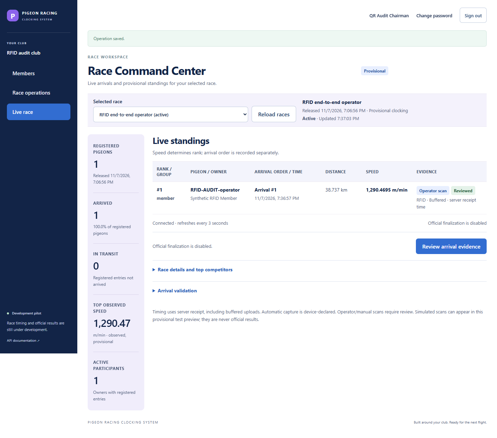
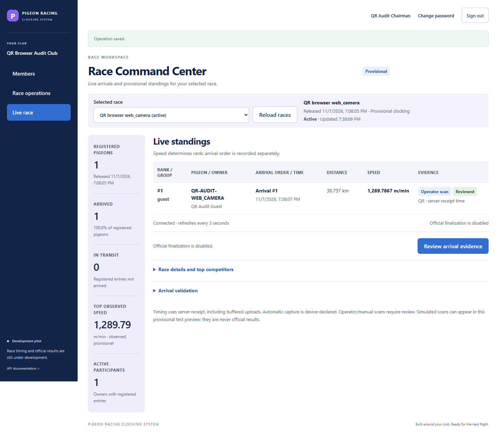
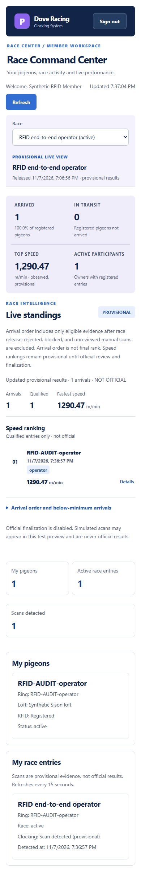

# Functionality audit — scan to arrival

Date: 7 November 2026. Scope: local `develop` at `b2029f4` plus the existing uncommitted work and audit changes. This is a local software audit, not a verification of the current Render deployment or physical RFID equipment.

## Outcome

The tested software path works from reader output / QR capture through durable recovery, authenticated receipt, validation, review, distance/speed calculation and provisional administrator/member standings. Tests use actual local FastAPI and PostgreSQL for the end-to-end cases. Hardware output and selected transport failures are synthetic.

Official finalization stays disabled. No production records, Render settings or production migrations were changed. No commit, push or deployment was performed.

## What was tested

| Layer | Final result | Evidence |
| --- | --- | --- |
| Full backend suite with PostgreSQL 16, migrations 001–014 | 121 passed | `backend/.pytest-tmp-flow-api-rerun-20261107/results.xml` |
| Gateway adapters, normalization, SQLite queue, retry and reconnect | 73 passed | `gateway/.pytest-tmp-flow-gateway-20261107/results.xml` |
| Edge browser: real QR/RFID/API/database paths, member security, responsive UI | 25 passed | `backend/.pytest-tmp-flow-browser-final-20261107/results.xml` |
| QR parsing and retry core in Node | 6 passed | `backend/tests/qr-core.test.cjs` run directly |

The final browser run passed all 25 scenarios in 232.29 seconds; a separate nine-case navigation regression rerun also passed after strengthening its scroll assertion.

Total: **225 passing tests** across these four suites. These totals count software tests, not physical flights, antennas, scanners or USB reader models. The browser test setup rejects databases outside the designated disposable localhost audit database and generates an isolated database for each real browser case.

## End-to-end paths

### 1. Guest QR camera — passed

The administrator browser creates the club, guest account, loft and verification, pigeon, draft race, entry and private QR label, then releases the race. The guest browser decodes the generated QR image through the real QR decoding code. Only camera pixels are injected; login, submission, database receipt and review APIs are real.

Verified:

- Correct guest/entry ownership and capture source.
- One stored pending event, with no QR secret copied into event metadata or browser recovery records.
- No live arrival before evidence approval.
- Administrator review and synthetic physical-inspection record.
- Positive distance, speed within configured limits and provisional guest rank.
- Server receipt time used for calculation; no official results created.
- Camera track cleanup, guest/admin sign-out and receipt recovery after race closure.

### 2. USB-style QR text and uncertain delivery — passed

Browser input substitutes for a physical scanner typing a code and Enter. In one case the real server commits and its acknowledgement is deliberately lost; in another the first submission never reaches the server. The page reloads, authenticates again, recovers receipts and rescans the same code.

Verified: stable submission identity, identical retry envelopes, one stored event, recovery ledger marked received, review before live eligibility, and no raw QR/password/session token persisted in browser storage.

This does not test an actual scanner's keyboard layout, line ending, focus or USB driver.

### 3. RFID gateway to administrator/member arrivals — passed

New regression coverage: `backend/browser_tests/rfid_live.py`, run for `operator`, declared `automatic`, and `simulated` modes.

Each case creates a member, verified synthetic Sison loft, pigeon, leading-zero electronic ring ID, registered/provisioned reader and active race using real APIs. A reading enters the actual adapter/SQLite queue and synchronization client, not a handcrafted substitute API payload.

The test then:

1. Injects an offline transport failure; confirms no server event exists yet.
2. Closes/reopens the SQLite queue; checks the original immutable envelope survives unchanged.
3. Delivers to the real API, loses the acknowledgement after commit and keeps the record pending locally.
4. Restarts/retries; receives the same event, leaving exactly one backend record.
5. Reports queue/reader state through an authenticated heartbeat.
6. Checks operator evidence is excluded until review, while declared automatic/simulator evidence follows existing provisional policy.
7. Approves evidence in the administrator browser; checks arrival, speed, distance and labels.
8. Signs in as the member in a phone-size browser; checks the same provisional pigeon appears.
9. Checks an unknown ring is rejected and retained locally without a new backend event.
10. Closes the race; confirms an exact received-message replay can recover its receipt and official finalization remains blocked.

The software fixture uses synthetic reader output and a controlled test-only release time. It does not establish physical detection, a real flight time, or whether a reader's automatic declaration is truthful.

### 4. Validation, permissions and ranking — passed in backend coverage

Coverage includes unauthorized accounts and device credentials; club/loft/entry ownership; revoked/rotated credentials; QR expiry/rotation; duplicate and conflicting identities; concurrent submission/closure; impossible speed and timestamp flags; first-eligible fallback after rejection; below-minimum qualification; immutable simulator provenance and official-result guards. Review approval cannot bypass blocking flags.

The distance calculation uses a great-circle release-to-loft distance from stored coordinates. Speed is distance divided by elapsed release-to-server-receipt time. The app does not measure the bird's actual traveled route. Rank follows full-precision speed within the configured group; arrival order is a different field.

### 5. Dashboard and session behavior — passed

Tests cover desktop/tablet/390px/320px layouts, review navigation preserving a selected race that is not first, telemetry modes, flagged-evidence disclosure, empty races, stale-feed recovery, safe text rendering, and member sign-out/session isolation. A late prior-session 401 cannot sign out a newer member session. Members cannot unlock the page with administrator credentials or see another member's private asset cards.

## Issues found and addressed

| Finding | Change / check |
| --- | --- |
| Success notice could overlap the desktop account controls after an actual evidence review | Added live-view spacing when a notice is visible. The RFID browser regression checks the notice begins below the account toolbar. |
| Switching administrator views could retain the previous scroll position | View navigation now returns to the top; the review shortcut still deliberately focuses the evidence section. Browser navigation regression checks this. |
| Gateway-to-browser arrival was previously split across queue tests and API tests | Added a real cross-component queue/restart/lost-ack/browser path for all three capture modes. Included it in the CI browser job. |
| Backend/user documentation contained outdated missing-feature and `not_probed` claims | Updated the supported capabilities, monitoring states, member screen, ranking labels, receipt/arrival distinction and offline limits. |

No new blocking authorization or calculation defect was reproduced in the tested paths. This is bounded by the tests above; it is not a guarantee that every endpoint, browser or adversarial input is covered.

## Remaining gaps and next priorities

1. **Physical hardware acceptance:** test the actual reader/ring/antenna in Surigao. Frequency alone does not guarantee compatibility. Generic short-range hand scans do not prove automatic pigeon-arrival capture. Windows local software was tested; physical Linux/Raspberry Pi/ESP32 deployments were not tested here.
2. **Trusted arrival time:** device capture time is untrusted. Offline uploads use server receipt for speed and can distort flight timing; new uploads after closure are rejected. Signed, tamper-resistant offline time and a trusted-clock acceptance policy remain outstanding.
3. **Official finalization:** intentionally disabled. Simulated records may have labeled development-preview ranks but cannot become official results. Approval/physical identity review is not clock certification.
4. **QR evidence limits:** static codes can be copied and scans are operator evidence. Browser recovery does not provide a fully offline application or save raw secrets for unattended upload. Rescanning can require the original valid code and same browser/device ledger.
5. **Operational acceptance:** no production load/capacity, backup/restore, restart/failover, live Messenger/provider delivery, or current Render migration/deployment audit was performed. Software fixture results should not be presented as those checks.
6. **Terminology/monitoring:** every durable gateway envelope is marked buffered, even when delivered online. A recent heartbeat is only gateway reachability; `waiting` is not continuous antenna-health proof. Dashboard arrival totals count eligible entries rather than every stored scan.
7. **User account operations:** self-service password reset and broader account/session lifecycle hardening remain separate work; device credential revocation is implemented and tested.

Next recommended acceptance session: follow the [Surigao hardware test guide](surigao-hardware-test-guide.md) for one known ring, one online delivery, one repeat, and one offline/restart/reconnect test before any official-racing claim.

## Evidence screenshots

All records shown below are synthetic. No production accounts, credentials or private QR labels are included.

### Reviewed RFID arrival



### Reviewed QR arrival



### Member phone view



## Reproducing the checks

Use a disposable local PostgreSQL 16 database, never production. Install backend/browser requirements and the local gateway package. From `backend/`, apply migrations with `python -m scripts.run_migrations`, then run `python -m pytest tests -q` with `DATABASE_URL` and `TEST_DATABASE_URL` pointing to that disposable database and a test-only JWT secret.

For browser tests, set `QR_AUDIT_DATABASE_URL` to a disposable localhost database specifically named `pigeon_qr_test`. Set `BROWSER_EXECUTABLE` to the installed Edge executable on Windows; CI uses installed Chromium. Run:

```text
python -m pytest browser_tests/rfid_live.py browser_tests/qr_live.py browser_tests/member_live.py browser_tests/qr_browser.py browser_tests/member_security.py browser_tests/workspace_browser.py -q
```

Each real browser case creates/migrates/drops a uniquely named child database and uses only synthetic accounts. Camera/reader input and selected connectivity failures are deliberately injected. Backend receipt, PostgreSQL persistence and server-side policy are real.

From `gateway/`, run `python -m pytest tests -q`. From the repository root, run `node --test backend/tests/qr-core.test.cjs`.

An initial audit run was interrupted by a roughly three-hour host pause: a test JWT correctly expired and one browser API startup deadline elapsed. Fresh uninterrupted runs passed. No production timeout or authentication policy was weakened to accommodate the tests. Final run reports, not the interrupted run, establish the results above.

## How to use the app

- [Complete user guide](user-guide.md): accounts, GPS/address, pigeons, races, QR, RFID gateway, review, standings, recovery and troubleshooting.
- [Surigao operator script](surigao-hardware-test-guide.md): remote hardware acceptance with expected outcomes and a test log.
